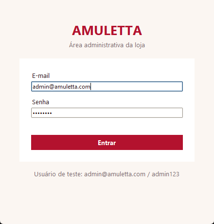
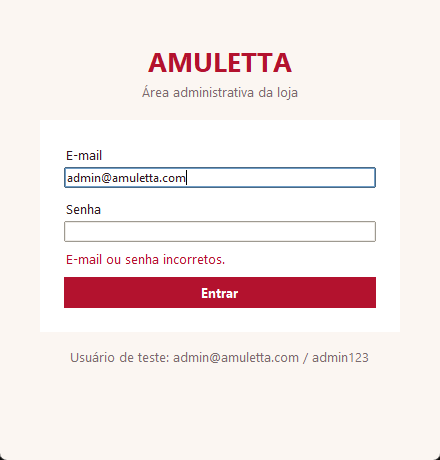
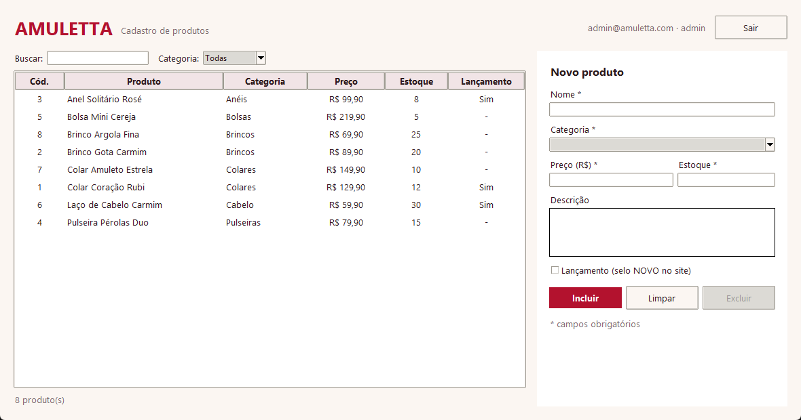
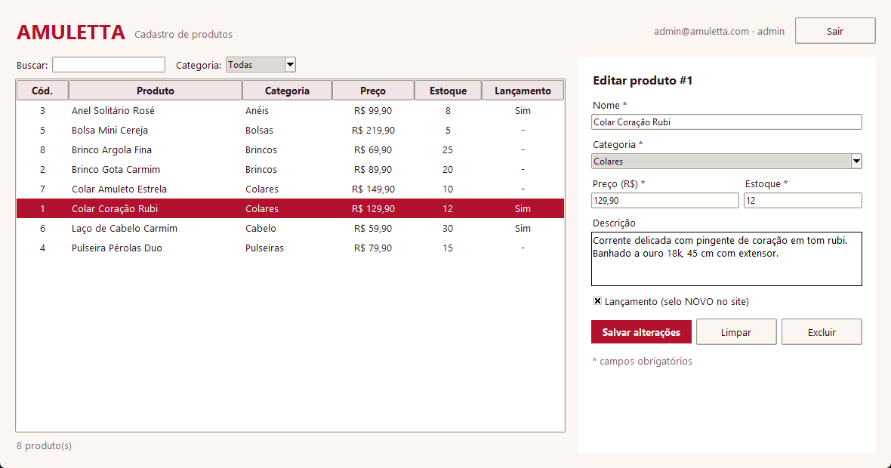

# Amuletta — Sistema administrativo

Projeto Integrador, fase **Implementação: bases do sistema (login e cadastro base / CRUD)**.

Aplicação desktop em **Python 3 + SQLite + Tkinter** para a equipe da loja Amuletta (acessórios femininos) entrar com login e manter o cadastro de produtos que aparecem na loja virtual ([protótipo do site](https://gabizrm-prog.github.io/amuletta/)).

## Telas

**Login**

 

**Cadastro de produtos (CRUD)**




## Funcionalidades

- **Login** com e-mail e senha validados no banco (senha guardada com hash PBKDF2-SHA256 + salt, nunca em texto puro).
- **Cadastro de produtos (CRUD)**
  - **Incluir** produto (nome, categoria, preço, estoque, descrição, lançamento)
  - **Consultar** com busca por nome/descrição e filtro por categoria
  - **Alterar** produto selecionado
  - **Excluir** com confirmação

## Como executar

Requer apenas Python 3.10+ (sqlite3 e tkinter já vêm com o Python).

```bash
python main.py              # abre o sistema (cria o banco se não existir)
python criar_banco.py       # cria o amuletta.db
python criar_banco.py --recriar   # apaga e recria com os dados iniciais
python -m unittest -v       # roda os testes
```

Usuários de teste:

| E-mail | Senha | Perfil |
|---|---|---|
| admin@amuletta.com | admin123 | admin |
| loja@amuletta.com | loja123 | funcionario |

## Estrutura

```
main.py            ponto de entrada (inicializa banco e abre a interface)
criar_banco.py     script de criação do banco
schema.sql         DDL das tabelas
amuletta.db        banco SQLite já populado
app/banco.py       conexão, criação das tabelas e dados iniciais
app/auth.py        módulo de login (cadastro de usuário e autenticação)
app/produtos.py    CRUD de produtos + validações
app/telas.py       telas Tkinter (login e cadastro de produtos)
tests/             testes automatizados (unittest)
docs/              relatório da fase (HTML e PDF) e prints das telas
```

## Documentação

Relatório completo (protótipos atualizados, dicionário de dados e especificação dos módulos): [`docs/relatorio.pdf`](docs/relatorio.pdf).
